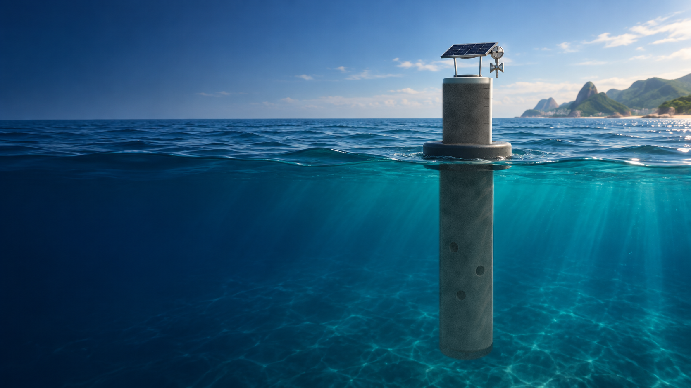
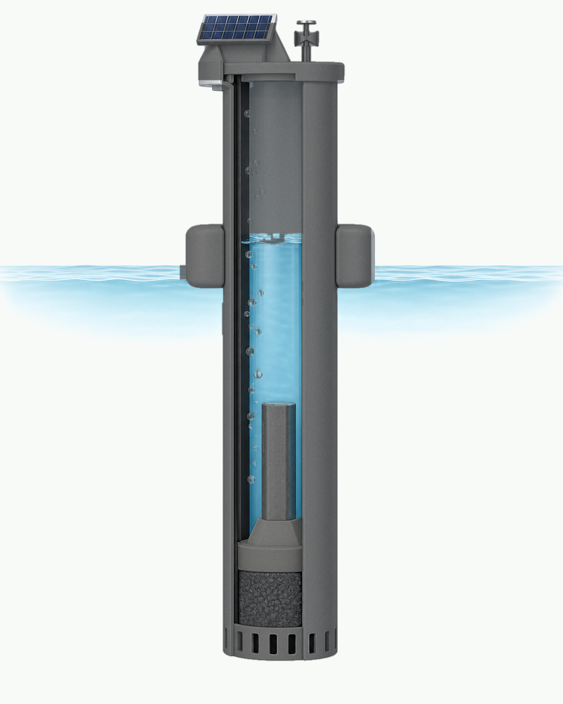
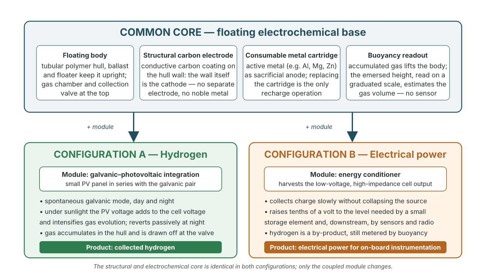
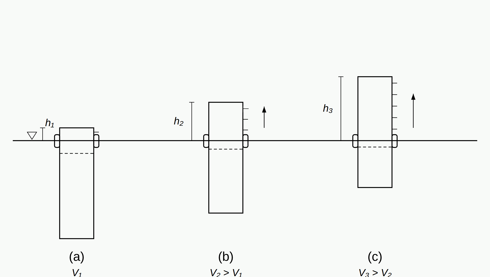
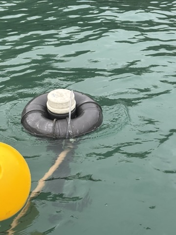

Bioē Project · Technical Report · October 2026

# The Bioē Floating Electrochemical Platform

## A modular floating base that produces hydrogen or electrical power from water, depending on the coupled module — system concept and proof of concept

Eduardo Galembeck

Institute of Biology, University of Campinas (IB/UNICAMP), Campinas, SP, Brazil Bioē Project — <a href="https://sites.google.com/unicamp.br/bioe">sites.google.com/unicamp.br/bioe</a>

Version 1.0 · 23 October 2026 · Licence: CC BY 4.0 · DOI: 10.5281/zenodo.23604905

<b>Abstract.</b> This report describes a floating electrochemical platform developed within the Bioē project for autonomous operation on lakes, reservoirs, aquaculture tanks, treatment plants and at sea. The platform is a single structural and electrochemical core — a floating tubular hull whose wall, coated with a conductive carbon layer, is itself the cathode; a replaceable cartridge of an electrochemically active metal that serves as the consumable anode; and a passive buoyancy-based readout of the gas accumulated inside the hull — onto which one of two modules is coupled. With a galvanic–photovoltaic integration module the unit becomes an on-site hydrogen generator that operates spontaneously day and night and intensifies under sunlight. With an energy-conditioning module the same cell is harvested as a low-voltage, high-impedance power source for on-board instrumentation, with hydrogen as a metered by-product. The core and the two configurations are described at system level, together with the operating principle, the stoichiometric orders of magnitude and the current proof-of-concept status: a prototype built from commercial materials has operated in the laboratory and been verified qualitatively at sea, with sustained gas evolution on the carbon surface, a positive flame test, a measurable rise of the body as gas accumulates and a perceptible intensification when the photovoltaic module is connected. No quantitative performance data are reported yet; the measurement campaign that will follow is outlined. The coating formulation, the cartridge internals and the circuit topology of the conditioner are not disclosed here.

<b>Keywords:</b> hydrogen production; metal–water reaction; sacrificial anode; carbon-coated electrode; floating device; buoyancy measurement; photovoltaic assistance; energy harvesting; autonomous buoys; decentralised energy.

## 1. Motivation

Instrumentation on the water — signalling buoys, monitoring stations, sensor nodes in reservoirs and aquaculture — needs energy where there is no grid, and maintenance visits are the dominant cost of keeping it running. Hydrogen, in turn, is attractive as a storable energy vector but is normally produced in centralised plants and transported in cylinders, which makes it impractical for small, remote consumers. The two needs look unrelated, yet they share a possible answer: an electrochemical cell that works with the water it floats on, needs no external power, has no moving parts and can be built from commodity materials.

The Bioē project (Institute of Biology, UNICAMP) develops low-cost electrochemistry for the marine environment — coated plates, bioelectrochemical generators and autonomous buoys. The platform described here grew out of that work. Its guiding idea is that a single floating electrochemical body can be configured for either of two products, hydrogen or electrical power, simply by changing the module coupled to it. This report presents the system as a whole: the common core, the two configurations, the operating principle, what has been verified so far and what remains to be measured.

## 2. System overview

The platform is organised in two layers (Figure 3). The **common core** is a floating body that contains water, hosts the electrochemical pair, accumulates the gas produced and reports how much gas it holds. A **coupled module** then determines the product: a galvanic–photovoltaic integration module for hydrogen (Configuration A) or an energy conditioner for electrical power (Configuration B). Nothing in the core changes between the two; a unit can in principle be converted from one role to the other in the field by swapping the module.

<figure>

<figcaption><b>Figure 1.</b> Conceptual visualisation of a single unit at sea: the tubular hull floats upright, the gas chamber and the collection valve are at the top, and a small photovoltaic panel (Configuration A) sits above the waterline. <i>AI-generated illustration for concept communication; not a photograph of the prototype (see Figure 5).</i></figcaption>
</figure>

### 2.1 The common core

**Floating body.** The unit is a vertical tubular hull of an insulating polymer. Openings near the bottom admit water, so that the interior is in free communication with the surrounding body of water. Ballast at the bottom and a floater at the waterline keep the hull upright. The upper part of the hull is a closed chamber where the gas produced inside accumulates and from which it is drawn off through a single valve at the top; the same valve serves to purge the chamber at start-up.

**Structural carbon electrode.** There is no separate cathode. The hull wall receives a conductive carbon-based coating, bonded to the polymer, and that coated wall is the electrode on which hydrogen is evolved. The whole inner surface in contact with the water is therefore electrode area, at the cost of a coat of paint rather than a metal part; no noble or catalytic metal is used. Electrical continuity of the coating is carried to an external terminal.

**Consumable metal cartridge.** Inside the hull, a replaceable cartridge of an electrochemically active metal — aluminium in the prototype; magnesium, zinc and their alloys are alternatives — acts as the anode. It is the only part consumed in operation. Replacing it is the recharge operation; the hull, coating and fittings are not discarded.

**Buoyancy readout.** As gas accumulates in the chamber it displaces water from the hull, the body rises, and the height emerging above the waterline is read on a graduated scale. The relation between emersed height and gas volume follows from the geometry of flotation alone (Section 4). The reading needs no sensor, no power and no electronics.

<figure>

<figcaption><b>Figure 2.</b> Simplified cutaway of a unit. The carbon-coated hull wall is the cathode; the central cartridge is the consumable anode; water enters through the lower openings; gas rises and accumulates in the upper chamber, below the valve; ballast and floater keep the body upright. Illustration simplified for clarity.</figcaption>
</figure>

### 2.2 One base, two configurations

<figure>

<figcaption><b>Figure 3.</b> Architecture of the platform. The core is identical in both configurations; only the coupled module changes.</figcaption>
</figure>

**Configuration A — hydrogen.** A small photovoltaic panel is connected in series with the galvanic pair, so that under illumination its voltage adds to the cell's own voltage and intensifies gas evolution. In the dark, or with the panel disconnected, the cell keeps working in its spontaneous galvanic mode: production continues, more slowly, around the clock. The product is the hydrogen collected at the valve; the buoyancy readout tells the operator when a collection is due.

**Configuration B — electrical power.** Instead of adding energy to the cell, the module extracts energy from it. The galvanic pair is a source of a few tenths of a volt with very high internal impedance, which is useless to electronics as it stands. The energy conditioner collects charge from that source slowly, without collapsing its voltage, and raises it to the level needed by a small storage element — and, downstream, by the microcontroller, sensors and radio of an autonomous buoy. Hydrogen is still evolved, now as a by-product, and is still metered by the buoyancy of the body. This is the configuration that connects the platform to the Bioē buoys, whose instrumentation is designed to be powered from the water they float on.

## 3. Operating principle

### 3.1 Spontaneous galvanic mode

An active metal and a carbon surface immersed in the same water form a galvanic cell. The metal is oxidised at the anode and water is reduced at the carbon cathode, releasing hydrogen; for aluminium in near-neutral water the overall reaction is

> 2 Al + 6 H₂O → 2 Al(OH)₃ + 3 H₂

with the anodic half-reaction Al → Al³⁺ + 3e⁻ (the cation precipitating as hydroxide) and the cathodic half-reaction 2 H₂O + 2e⁻ → H₂ + 2 OH⁻ on the coating. The reaction is spontaneous: there is no source, battery or grid involved. Its rate is set by the cell potential, by the ohmic path through the water and the coating, and by the condition of the metal surface; it therefore depends on water conductivity (seawater is favourable) and on the metal and alloy used. Because the anodic reaction in this regime is metal dissolution rather than oxygen evolution, the gas evolved at the cathode is expected to be hydrogen without an oxygen counterpart in the same chamber — an important difference from water electrolysis with inert electrodes, where the two gases must be kept apart. This expectation is consistent with the flame tests performed so far, but the gas composition has not yet been measured (Section 6).

### 3.2 Photovoltaic intensification (Configuration A)

Connecting a photovoltaic panel in series with the pair, with the polarity that drives current in the same direction as the galvanic current, adds the panel voltage to the cell voltage and increases the current — and with it the rate of hydrogen evolution — whenever there is light. When light fails, the panel contributes nothing and the arrangement reverts to the galvanic mode by itself; a blocking diode prevents the cell from discharging through the panel. The result is a device that always produces, and produces more under the sun, with no controller, battery or switching.

### 3.3 Energy extraction (Configuration B)

In Configuration B the cell is treated as a power source. Its characteristics — a few tenths of a volt and currents of the order of a milliampere, behind a very high impedance — are those of microbial and other bioelectrochemical sources, and the Bioē project faces the same problem in its biofilm-colonised carbon plates. The conditioning stage developed for these sources is purely passive: it accumulates charge slowly, so as not to pull the source voltage down, and transfers it in pulses to a storage element at a higher voltage, from which a conventional step-up stage feeds the instrumentation. No controller IC, clock or inductor is involved. The topology is not described in this report (Section 7); bench operation of the stage has been reported by its designer and its quantitative characterisation is part of the planned campaign.

### 3.4 Orders of magnitude

Stoichiometry sets the frame. One kilogram of aluminium yields at most 0.112 kg of hydrogen (about 1.24 Nm³) and leaves about 2.9 kg of aluminium hydroxide; conversely, each kilogram of hydrogen costs about 8.9 kg of aluminium. These are theoretical limits at 25 °C; the real yield depends on the fraction of the metal that reacts usefully, which has not yet been measured. The by-product, aluminium hydroxide, is a low-toxicity solid in routine use as a flocculant in water treatment.

Two consequences follow. First, the consumable is a cartridge, and the metal, not the water, is the input to be managed; nothing else is consumed. Second, the technology makes sense not as commodity hydrogen but where the value lies in independence from the grid, from cylinder logistics and from maintenance visits — and capacity is scaled by adding identical units rather than by building a larger one.

## 4. Buoyancy as a gauge

A floating body in equilibrium displaces a weight of water equal to its own weight. As gas accumulates in the chamber it expels water from the hull, the total weight of the body decreases, and the body rises until equilibrium is restored. For a hull of constant cross-section *A* the volume of gas held is, to first order,

> *V* = *A* · (*h* − *h*₀)

where *h* is the emersed height and *h*₀ the emersed height with the chamber flooded. The relation involves only the geometry of the hull and the equilibrium of flotation; for a non-prismatic hull it generalises by integrating the cross-section over height. It is calculable at the design stage, and a scale graduated in volume can be printed directly on the hull.

<figure>

<figcaption><b>Figure 4.</b> Principle of the buoyancy readout: as the gas volume held in the hull increases from (a) to (c), the body rises and the emersed height <i>h</i> increases. The graduated scale on the hull converts <i>h</i> into volume.</figcaption>
</figure>

The reading is a geometric volume at the pressure and temperature prevailing in the chamber. Converting it to a normalised volume or an amount of substance requires the usual pressure and temperature corrections, and the readout is sensitive to waves, fouling and anything else that alters the flotation equilibrium. It is a gauge for operation — when to collect, whether production has stalled — rather than a laboratory instrument; its calibration against injected volumes is one of the planned measurements.

## 5. Modularity and deployment

Each unit is autonomous. Capacity is obtained by placing several identical units side by side, optionally connected to a common gas manifold in Configuration A; there is no single point of failure and no component whose size grows with the installation. Because the units float, they occupy no land and need no foundation, and because they have no moving parts and nothing on board that needs attention between cartridge changes, they suit places visited rarely.

The settings envisaged are lakes and reservoirs, aquaculture tanks and ponds, water and wastewater treatment plants, and the sea. In Configuration A the hydrogen is consumed close to where it is made — in a fuel cell feeding remote instrumentation, in small-scale heating or as a feedstock. In Configuration B the platform is itself the power supply of an autonomous buoy, the application that motivated the Bioē project in the first place.

## 6. Proof-of-concept status

A prototype was built with commercial materials — a PVC hull, a graphite-based conductive paint, an aluminium cartridge, standard fittings and a small photovoltaic panel — operated in the laboratory and then verified qualitatively at sea, supported by a flotation ring (Figure 5). Table 1 summarises what has been observed and what has not yet been measured.

<figure>

<figcaption><b>Figure 5.</b> The prototype in the water, held by a flotation ring. The hull, submerged, carries the conductive carbon coating that gives it its grey colour; the white cap at the top closes the gas chamber.</figcaption>
</figure>

**Table 1.** Current status of each function.

| Function | What has been observed | What has not been measured yet |
|---|---|---|
| Gas evolution | Sustained bubbling on the carbon surface; flame test characteristic of hydrogen | Volume, production rate, gas composition, dependence on water conductivity |
| Buoyancy readout | Progressive rise of the body as gas accumulates; return after collection | Calibration of emersed height against known volumes; resolution; effect of waves |
| Photovoltaic intensification (A) | Perceptible increase in bubbling under illumination; return to passive mode without light | Current and production rate with and without the panel; day/night cycles |
| Energy conditioning (B) | Bench operation of the conditioning stage reported by its designer | Energy delivered to the storage element; efficiency; long-term operation on a real cell |
| Coating and cartridge | Electrical continuity of the coating verified; cartridge consumed as expected | Sheet resistance, adhesion and durability under prolonged immersion; metal utilisation |

The status is that of a proof of concept: every function has been seen to work, none has been quantified. The next step is a measurement campaign with low-cost methods available in-house — gas volumetry by water displacement (or by the buoyancy readout itself), cartridge mass loss against cumulative gas to obtain the metal utilisation, open-circuit voltage and operating current over time, production with and without the panel, gas composition by a hydrogen sensor and, where a partner laboratory is available, gas chromatography, and calibration of the buoyancy gauge against injected volumes. Those results will be reported as a second version of this record or as a journal article.

## 7. What this report does not disclose

Three elements are deliberately left out. The formulation and application of the conductive coating (composition, binder, number of coats, verification criteria) are described only as "a conductive carbon-based coating". The internal construction of the metal cartridge is described only by its function. The circuit topology of the energy conditioner is described only at block level. These are the parts of the platform held as know-how by the development group; everything else — the architecture, the operating principle, the two configurations and the buoyancy gauge — is disclosed here in full so that the system can be understood, discussed and built upon.

## 8. Intellectual-property and disclosure note

The elements of the platform were communicated to the innovation agency of the University of Campinas (Inova Unicamp) as invention disclosures between July and August 2026. After analysis, the University decided not to pursue patent protection, and the development group chose scientific disclosure as the route forward. This report is the public disclosure of record for the system as a whole. The author's research group keeps the full development history under version control.

## 9. Outlook

The platform is a base, not a finished product. Its generality — the same body serves whoever needs hydrogen at the point of use and whoever needs power for instrumentation on the water — is what the group intends to develop. The immediate priorities are the measurement campaign of Section 6, the comparison of anode metals and alloys in fresh and salt water, the long-term behaviour of the coating under immersion and fouling, and a first multi-unit deployment. Collaboration on any of these fronts, in particular on gas analysis and on field deployments, is welcome.

## Acknowledgements

Fernando Galembeck contributed the concept of the carbon-coated structural electrode. Edson A. Duarte designed and bench-tested the energy-conditioning stage. The Bioē project is supported by FAPESP (Grant #2025/0787809, PROASA programme). This study was carried out with support from FAPESP (Grant #2025/0787809).

## References

1. Wang, H. Z.; Leung, D. Y. C.; Leung, M. K. H.; Ni, M. A review on hydrogen production using aluminum and aluminum alloys. *Renewable and Sustainable Energy Reviews* **2009**, *13*, 845–853.
2. Pacheco, J. M. Galvanic hydrogen generator. US Patent 5,089,107, 1992.
3. Oloman, C. W. et al. Method and apparatus for producing hydrogen using a sacrificial anode. US Patent 5,968,325, 1999.
4. Tender, L. M. et al. The first demonstration of a microbial fuel cell as a viable power supply: powering a meteorological buoy. *Journal of Power Sources* **2008**, *179*, 571–575.
5. Bioē Project — Marine bioelectrochemistry at IB/UNICAMP. https://sites.google.com/unicamp.br/bioe (accessed October 2026).

How to cite: Galembeck, E. (2026). <i>The Bioē Floating Electrochemical Platform: a modular floating base that produces hydrogen or electrical power from water — system concept and proof of concept.</i> Technical Report, Bioē Project, IB/UNICAMP. Zenodo. <a href="https://doi.org/10.5281/zenodo.23604905">https://doi.org/10.5281/zenodo.23604905</a>

